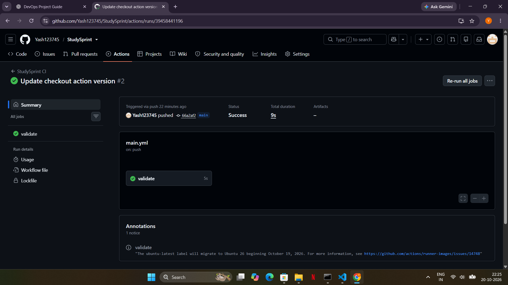
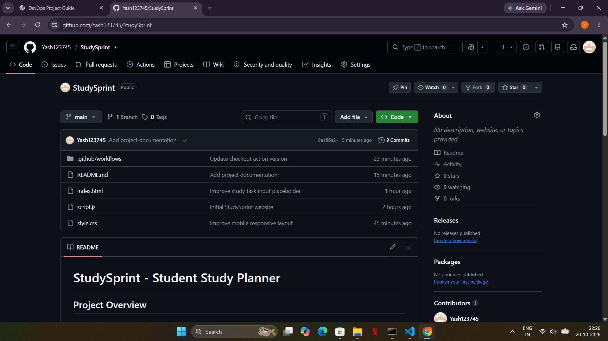
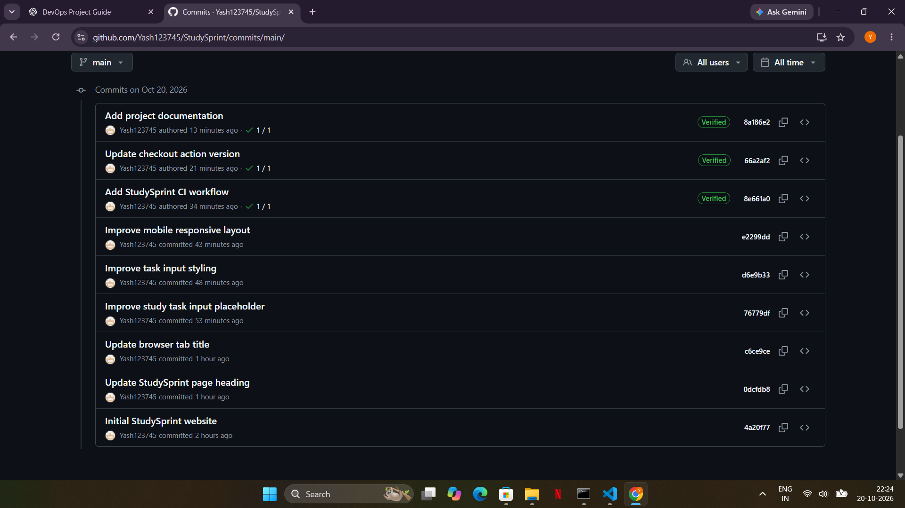
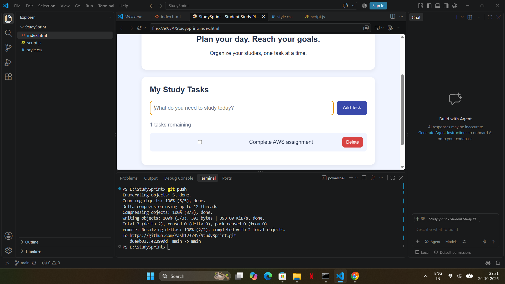

# StudySprint - Student Study Planner

## Project Overview
StudySprint is a simple website that helps students organize their study tasks. Students can add tasks, mark them as completed, and delete tasks.

## Objectives
- Make study planning simple and organized.
- Help students track completed tasks.
- Provide a simple and user-friendly interface.

## Technologies Used
- HTML
- CSS
- JavaScript
- Git and GitHub
- GitHub Actions

## Features
- Add study tasks.
- Mark tasks as completed.
- Delete tasks.
- Save tasks in the browser using localStorage.
- Responsive styling for smaller screens.

## DevOps Tool: GitHub Actions
GitHub Actions is used to automatically validate the project when changes are pushed to the main branch.

The workflow checks that:
1. index.html exists.
2. style.css exists.
3. script.js exists.
4. The JavaScript syntax is valid.

## Testing
The GitHub Actions workflow ran successfully, confirming that the required project files are present and the JavaScript syntax check passed.

## Version Control
Git and GitHub were used to track project changes. Multiple commits document improvements to the website and its workflow.

## Conclusion
StudySprint demonstrates how a simple website can be developed and maintained using version control and automated checks through GitHub Actions.

## Screenshots / Evidence

### 1. GitHub Actions Success

### 2. Repository Files

### 3. Git Commit History

### 4. Working Website

